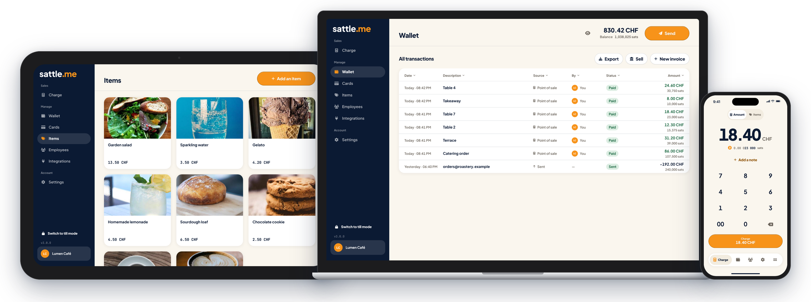
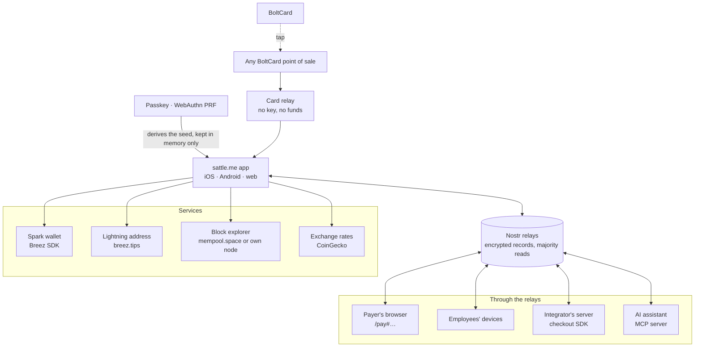
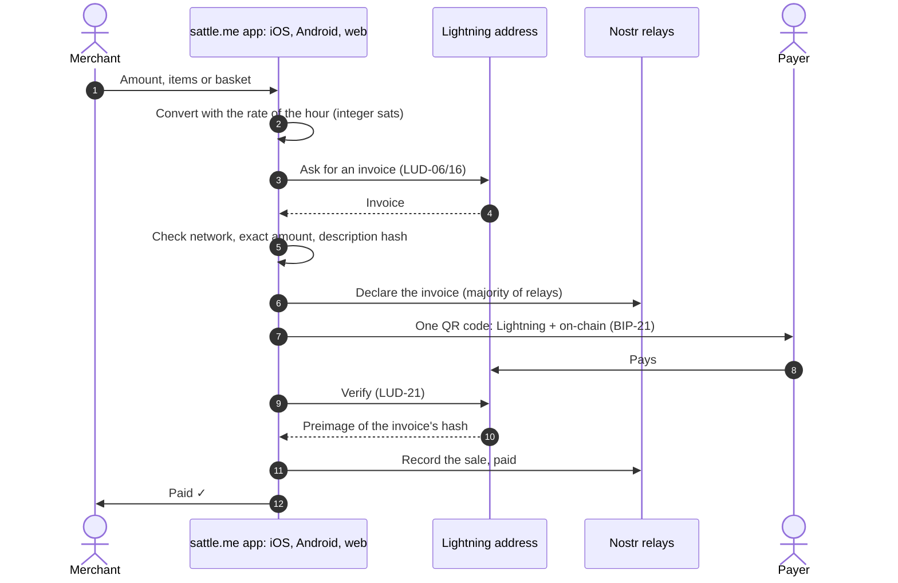

<p align="center">
  <picture>
    <source media="(prefers-color-scheme: dark)" srcset="assets/images/splash-logo-dark.png">
    
  </picture>
</p>

<h3 align="center">Private Bitcoin and Lightning payments for businesses, on every device</h3>

<p align="center">Point of sale · Invoices · Payment links · NFC cards · E-commerce integrations · AI assistant</p>

<p align="center">
  
</p>

<p align="center">
  
  
  
  
  
  
</p>

<p align="center">
  <a href="#overview">Overview</a> · <a href="#features">Features</a> ·
  <a href="#how-it-works">How it works</a> · <a href="#security-model">Security</a> ·
  <a href="#getting-started">Getting started</a> · <a href="#releases">Releases</a> ·
  <a href="#documentation">Documentation</a>
</p>

---

## Overview

**sattle.me** is the iOS, Android and web app with which a business accepts bitcoin, on Lightning and
on-chain, and manages what it receives. It is built on [Expo](https://expo.dev), React Native and
the [Breez SDK (Spark)](https://sdk-doc-spark.breez.technology/), and replaces the **Swiss Bitcoin
Pay** app, whose merchants move to it in a few taps.

The app follows a few principles:

| Principle              | What it means                                                                                                                                                      |
| ---------------------- | ------------------------------------------------------------------------------------------------------------------------------------------------------------------ |
| **Non-custodial**      | Each wallet's seed is derived on the device from its owner's **passkey** and lives in memory only. sattle.me never sees it.                                        |
| **No server**          | sattle.me runs no API of its own. The device talks to the Breez SDK, Nostr relays, the merchant's Lightning address, an exchange-rate source and a block explorer. |
| **Encrypted on Nostr** | Settings, team, catalogue, sales and payment links are end-to-end encrypted records on public Nostr relays: a passkey finds them again on any device.              |
| **Exact money**        | Amounts are integer satoshis (`bigint`) and integer fiat minor units from end to end, never floating point, never rounded silently.                                |
| **Nothing unproven**   | A sale is "paid" only with a cryptographic proof. "Not read yet" is never shown as "unpaid", "expired" or "empty".                                                 |
| **One interface**      | The same screens on iPhone, iPad, Android and the web (react-native-web), in light and dark themes and seven languages.                                            |

## Features

### Charge — the point of sale

- **Three ways to ring up a sale**: type an **amount**, tap **items** from the catalogue, or
  **scan** product barcodes with the camera into a basket (quantities, note, review before
  charging).
- **One QR code for every wallet**: a Lightning invoice and, from 1,000 sats, an on-chain deposit
  address of the merchant's wallet in a single BIP-21 code. Above the Lightning address's ceiling,
  the sale goes on-chain only.
- **No wallet needed at the till**: invoices come from the merchant's Lightning address (LUD-06/16)
  and on-chain payments go to deposit addresses prepared beforehand, so the point of sale works
  without the passkey and without connecting the wallet.
- **A live sale screen**: countdown (10 minutes), "confirming", "paid", "underpaid" with the rest
  payable in Lightning or on-chain, "expired"; an optional underpayment tolerance for on-chain
  payments (0 to 10 %).
- **BoltCard payments** at the till (LUD-03), and a **payment link** to let the payer finish on
  another device.
- **Till mode**: after 5 minutes without activity the device locks to the point of sale; only the
  passkey opens the rest of the account. An optional **biometric lock** hides the whole app on
  iOS and Android.

### Wallet

- Balance, **"To follow"** (sales in progress, open or underpaid links, on-chain payments being
  confirmed) and the full **activity**: sales, payment links, invoices and transfers, with the
  employee who took each one.
- **Send** to a Lightning address, Lightning invoice, LNURL, bitcoin address or Spark address,
  fees shown before sending, the passkey asked for each payment.
- **Sell to fiat without KYC** under 1,000 CHF a month, from 10 sats, with
  [Mt Pelerin](https://www.mtpelerin.com), who transfers it to the merchant's bank account; the
  **split** offers to sell the chosen share of what came in, in one gesture.
- **Export** transactions as CSV or PDF for the accountant.
- **Funds recovery**: sats that leave the balance on-chain (Spark watchtower, unilateral exit) are
  brought back automatically.

### Invoices and payment links

- **Invoices** in five steps (recipient, lines, due date, notes, review) with VAT, numbering in the
  business's own series, a **PDF** in any of the app's languages, sending by mail, reminders and
  drafts.
- **Payment links** (`/pay#…`): the payer's browser runs the sale itself on the web app, with
  Lightning and on-chain, copy buttons in BTC, sats or fiat, and the merchant's name once the sale
  ends. The link's fragment is never sent to the web host.

### Items

A catalogue of items (name, photo, exact price, description), encrypted on the relays. In the apps,
scanning an unknown barcode can prefill its name and photo from
[Open Food Facts](https://world.openfoodfacts.org), while the owner allows it.

### Team

- **Employees** join by an invitation link or QR code. Their devices get keys derived for them,
  never the seed nor the wallet: they charge and see their own activity.
- Removing an employee rotates the catalogue's key, so they read nothing published afterwards.

### Integrations

Online shops and servers take payments for the merchant with a revocable secret key
(`sattleme_ck_…`), on the integrator's own server. Plugins and guides for **WooCommerce, Wix,
be-BOP, pretix, GrandNode, nopCommerce, Smartstore, PrestaShop and Magento**, and server packages
for **Node.js** ([sattleme/checkout-node](https://github.com/sattleme/checkout-node)), **Python**
([sattleme/checkout-python](https://github.com/sattleme/checkout-python)), **PHP**
([sattleme/checkout-php](https://github.com/sattleme/checkout-php)), **Rust**
([sattleme/checkout-rust](https://github.com/sattleme/checkout-rust)), **Java**
([sattleme/checkout-java](https://github.com/sattleme/checkout-java)), **.NET**
([sattleme/checkout-dotnet](https://github.com/sattleme/checkout-dotnet)), **Ruby**
([sattleme/checkout-ruby](https://github.com/sattleme/checkout-ruby)) and **Go**
([sattleme/checkout-go](https://github.com/sattleme/checkout-go)). The
protocol is specified in [sattleme/checkout-spec](https://github.com/sattleme/checkout-spec); see
[docs/integrations.md](docs/integrations.md).

### AI assistant

An MCP server ([sattleme/mcp-server](https://github.com/sattleme/mcp-server)) lets an AI app —
Claude, ChatGPT or any MCP client — **make the business's real invoices**, follow their payment and
export transactions for the accountant, with a key the owner can revoke. It is hosted at
`mcp.sattle.me` (it stores nothing: the key travels sealed in its tokens), available as a Claude
Desktop bundle, or self-hosted. **An assistant never pays.**

### Cards

- Program a **BoltCard** (NTAG 424 DNA) with the phone. It pays at any point of sale that accepts
  BoltCards: the tap reaches the phone through the card's relay, and the phone pays **from the
  card's own wallet**.
- **Limits** per payment, per day and per hour (by default 20,000 sats, 50,000 sats and 5
  payments), and a mode: pay every tap, pay **approved merchants** only (default), or confirm every
  payment.
- On Android, cards also pay **with the app closed** (a foreground service keeps the connection to
  the relay).
- The relay holds no key and no funds, and a holder can use their own: see
  [docs/card-relay.md](docs/card-relay.md).
- **"Where to pay"**: a map of merchants that accept bitcoin, from [BTC Map](https://btcmap.org).
- **"Order cards"**: wherever the app offers to add a card, cards of the
  [sattle.me shop](https://shop.sattle.me) and a button that opens it in the browser.
- An account can be a **card holder's only**: cards and settings, no point of sale nor merchant wallet.

### Account, safety and comfort

- **Recovery phrase**: the wallet's 12 words, shown after the passkey, never stored nor offered to
  copy; screen capture is blocked while they show. A **yearly check** of the 12 words keeps payments
  open.
- **Rescue mode**: open the account with the 12 words alone (if the passkey or its domain is lost)
  to see every wallet, empty it to another address and export the history.
- **Nostr relays**: five public relays by default, replaceable by the merchant's own (up to ten),
  with a connection test; your **own Bitcoin node** (mempool, e.g. Umbrel or Start9) instead of
  mempool.space.
- **Delete the account**: refused while any wallet holds funds; then deletion requests (NIP-09) for
  everything the account signed on the relays.
- Light, dark or automatic **theme**; available **languages**: French, English, German (with a Swiss
  variant), Italian, Spanish, Portuguese and Finnish; numbers and dates in the device's locale.
- **"Contact support"** writes a mail with the app's journal attached (optional).
- An **installable web app** (Chrome, Edge, Safari "Add to Home Screen" / "Add to Dock"), with no
  service worker.

### Migration from Swiss Bitcoin Pay

A device that ran the Swiss Bitcoin Pay app opens on the migration: the old account is read once,
then frozen on the old server, its coins move to the new account's wallet, employees are re-invited
and its history is copied for reference. Any other device starts it from the welcome screen
("Migrate my Swiss Bitcoin Pay account").

## How it works



### The building blocks

| Block              | Role                                                                                                                                                                                         | Code                                      |
| ------------------ | -------------------------------------------------------------------------------------------------------------------------------------------------------------------------------------------- | ----------------------------------------- |
| **Passkey → seed** | A passkey (WebAuthn with the PRF extension) gives the wallet's seed. It lives in memory with the open account, and the wallet connects only while something needs it.                        | `src/lib/breez/`, `src/features/account/` |
| **Breez SDK**      | The payment engine: native package on iOS and Android, WebAssembly on the web. Every call goes through one managed connection.                                                               | `src/lib/breez/`                          |
| **Nostr records**  | Every app record is a kind 30078 event with an opaque address, NIP-44 encrypted and padded, its signature checked. Decisions read a majority of the relays, so any two majorities share one. | `src/lib/nostr/`                          |
| **Backup**         | The merchant's settings live on the device and are backed up encrypted on the relays.                                                                                                        | `src/lib/backup/`                         |
| **Registry**       | Every invoice is declared on a majority of the relays before its code is shown, so that no two sales claim the same payment.                                                                 | `src/lib/registry/`                       |
| **Team roster**    | One record per seat (employee, integration, assistant), written and read by the owner's devices only.                                                                                        | `src/lib/team/`                           |
| **Cards**          | Keys derived from the wallet, programmed by the phone; each card has its own wallet and records of its state, limits and payments.                                                           | `src/lib/card/`, `src/features/card/`     |
| **Rates**          | An amount is fixed only with the rate of its hour; during an outage no amount is fixed.                                                                                                      | `src/lib/rates/`                          |

### Life of a sale at the point of sale



A payment counts only with the preimage of the invoice's hash from a LUD-21 answer naming that very
invoice, and only when no other sale declared it. On-chain, a payment is "confirming" as soon as it
is seen and "paid" at 3 confirmations, valued at the rate of the hour its transaction was sent. A
sale whose screen was left keeps being followed in the background until its verdict is recorded.

## Security model

- **No custody, no server.** sattle.me holds no key and no funds. The only services it runs hold
  neither: the open-source card relay, which the user can replace, and the hosted MCP server, which
  stores nothing and the user can also replace.
- **The seed never leaves memory**: never stored, logged nor written in the code. Keys derived from
  it are wiped when the account closes.
- **The passkey is asked before each payment sent.** The documented exceptions are card payments
  within the card's limits and mode, and rescue mode, where the 12 words just typed confirm.
- **No over-the-air updates in production.** Nobody, even with access to the Expo account, can push
  JavaScript to production users: every production change is a reviewed store release.
- **Everything from outside is untrusted**: relay events, LNURL and explorer answers, URL fragments,
  QR codes, the clipboard and stored data are validated before use.

Found a vulnerability? Please report it **privately**, as described in [SECURITY.md](SECURITY.md)
(GitHub private vulnerability reporting, or `security@sattle.me`, PGP key in
[`public/.well-known/pgp-key.txt`](public/.well-known/pgp-key.txt)).

<details>
<summary><strong>Third parties the app talks to</strong></summary>

<br>

Each of these receives the device's IP address and what the app asks it.

| Service                                   | Why                                                                         |
| ----------------------------------------- | --------------------------------------------------------------------------- |
| Breez SDK and Spark                       | The wallet itself                                                           |
| breez.tips                                | The merchant's Lightning address (invoices, payment proofs)                 |
| Nostr relays                              | Encrypted records of the account, its team, sales and links                 |
| CoinGecko                                 | Exchange rates                                                              |
| mempool.space, or the merchant's own node | Watching on-chain addresses                                                 |
| BlockCypher                               | The send time of some on-chain transactions, replaced transactions          |
| country.is                                | Payout currency at sign-up, only when the time zone is not enough           |
| Open Food Facts                           | Scanned products' names and photos, while allowed                           |
| Card relay                                | Card taps (default `relay.sattle.me`, replaceable)                          |
| A card payment's merchant service         | Its verify URL                                                              |
| Expo Push                                 | Push notifications                                                          |
| Expo Observe                              | Crash and performance reports of release builds, while the device allows it |
| Mt Pelerin                                | Selling sats                                                                |
| BTC Map                                   | The "Where to pay" map, and the position when asked on it                   |
| Swiss Bitcoin Pay's server, `sbpc.ch`     | Migration and history of former accounts and cards; Android's link checks   |
| GitHub API                                | The latest Claude Desktop bundle or shop plugin, once its steps show        |

</details>

## Platforms

|                | Minimum                                  |
| -------------- | ---------------------------------------- |
| iOS and iPadOS | 18.0 (passkeys with PRF), iPad supported |
| Android        | 9 (API 28)                               |
| Web            | A recent browser with passkeys (PRF)     |

## Tech stack

| Area         | Choice                                                                                  |
| ------------ | --------------------------------------------------------------------------------------- |
| App          | Expo · React Native · React (React Compiler) · TypeScript                               |
| Navigation   | Expo Router · react-native-web                                                          |
| Payments     | Breez SDK Spark (native on iOS and Android, WebAssembly on the web)                     |
| Cryptography | `@noble/hashes`, `@noble/curves`, `@noble/ciphers`, `@scure/bip32`, `@scure/btc-signer` |
| UI           | `StyleSheet` with design tokens · Reanimated · Plus Jakarta Sans, JetBrains Mono        |
| Languages    | i18next · react-i18next                                                                 |
| Tests        | Jest · React Native Testing Library, with fakes of the external services                |

## Getting started

**Prerequisites**: Node `22.23.5` (see [`.nvmrc`](.nvmrc): `nvm install && nvm use`) and the npm
it ships with (10.x). npm stops with `EBADDEVENGINES` on another Node line or npm major
(`devEngines` in `package.json`): npm 12 would refuse the Breez SDK's dependency fetched from
GitHub (`EALLOWGIT`). For Android: JDK 17+ and the
Android SDK ([`scripts/setup-android-sdk.sh`](scripts/setup-android-sdk.sh) installs it without
Android Studio). For iOS: macOS and Xcode.

```bash
npm install
```

Copy [`.env.example`](.env.example) to `.env.local` (ignored by git) and fill it in:

| Variable                            | Purpose                                                                             |
| ----------------------------------- | ----------------------------------------------------------------------------------- |
| `EXPO_PUBLIC_BREEZ_API_KEY`         | Breez API key. Without it the app starts but connects no wallet.                    |
| `PASSKEY_RP_ID`                     | The passkeys' domain. Without it, no passkey.                                       |
| `EXPO_PUBLIC_OPEN_FOOD_FACTS_EMAIL` | Contact address that Open Food Facts asks for in the User-Agent of barcode lookups. |

> [!CAUTION]
> `EXPO_PUBLIC_*` variables are inlined into the JavaScript bundle: they are **not** secret. Never
> commit a real key.

Then run the app on Android, iOS or the web:

```bash
npm run android
```

```bash
npm run ios
```

```bash
npm run web
```

> [!NOTE]
> Passkeys only work on a domain that declares the app (its association files). On `localhost` the
> web app shows its screens, but signing in fails.

To check a change, run the linter, the type checker, the formatting check and the tests:

```bash
npm run check
```

## Project structure

```text
app.config.ts          the native configuration of the app
index.ts               the app's entry point
modules/               the app's own native modules (Expo Modules API)
plugins/               Expo config plugins
src/
├── app/               Expo Router routes: every file is a screen
├── components/        design system (ui/) and screen frames (layout/)
├── config/            business settings: currencies, relays, on-chain, cards, …
├── features/          screen logic shared by several routes
├── lib/               non-UI code: breez/, nostr/, backup/, team/, registry/, card/, …
├── theme/             design tokens: colours, type, spacing, shadows, motion
├── i18n/              i18next and translations (French is the source)
└── __tests__/         Jest tests
jest/                  fakes of native modules, Breez SDK, Nostr relays, explorers, NFC cards
scripts/               build and deploy tooling: passkey association files, web manifest, local APK
docs/                  overviews of the integrations and the card relay
```

`android/` and `ios/` are generated by `expo prebuild` and never committed: native behaviour is
configured in `app.config.ts` and `plugins/`.

## Quality

- **Tests for everything that matters**: more than 400 test files, run against fakes of the Breez
  SDK, Nostr relays, block explorers, card relays, NFC cards (an
  NTAG 424 DNA at the APDU level), the camera and background tasks. Tests never reach the network.
- **The same checks on every pull request**: CI (GitHub Actions) runs lint, typecheck, format check,
  the web and Android bundles and the tests; no test, lint rule or type is weakened to get green.
- **Irreversible things are locked by tests**: persisted names, data formats, key derivations,
  released link formats and the card relay's host, so that no update loses users' data or funds.

## Releases

A production release never receives **over-the-air updates**.

## Documentation

| Document                                     | Subject                                                        |
| -------------------------------------------- | -------------------------------------------------------------- |
| [docs/integrations.md](docs/integrations.md) | Integrations: how a shop's server takes payments               |
| [docs/card-relay.md](docs/card-relay.md)     | BoltCards and the card relay                                   |
| [SECURITY.md](SECURITY.md)                   | Reporting a vulnerability                                      |
| [AGENTS.md](AGENTS.md)                       | The codebase's rules, and what must never change once released |

Related repositories: the integrations' specification
([sattleme/checkout-spec](https://github.com/sattleme/checkout-spec)), the assistant's server
([sattleme/mcp-server](https://github.com/sattleme/mcp-server)) and the card relay
([sattleme/relay](https://github.com/sattleme/relay)).

## Contributing

Read the code, comments and tests of an area before changing it, and keep `npm run check` green.
Everything is written in English, except the app's translations (`src/i18n/locales/`); commits
follow Conventional Commits.

The codebase's rules, and what must never change once released, are in [AGENTS.md](AGENTS.md).
